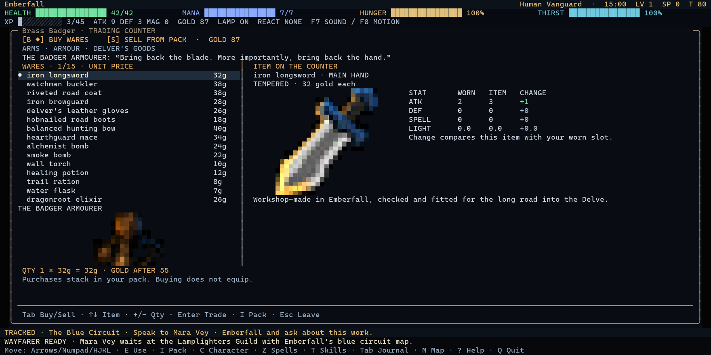

# LumenRogue

A true-colour terminal roguelike about shared light and broken oaths. Exploration
and combat are turn-based; torchlight, spell trails, explosions and other effects
animate continuously. Everything on screen is terminal text, including the
coloured half-block portraits and item artwork.

## Play on Windows

**[Download the Windows x64 executable](https://github.com/MaxDowney/LumenRogue/releases/latest/download/LumenRogue-CPP.exe)**

The [Releases page](https://github.com/MaxDowney/LumenRogue/releases) also provides
a ZIP with a quick-start guide and SHA-256 checksums. Use the executable asset,
not GitHub's source-code archive, to play without building.

Requires 64-bit Windows 10/11 and a terminal supporting ANSI true colour.
Windows Terminal is recommended. The executable is statically linked: no .NET
runtime, extra DLLs or external assets are needed. It is currently unsigned.

Save it in a writable folder and launch it there:

```powershell
.\LumenRogue-CPP.exe
.\LumenRogue-CPP.exe --seed 94117
.\LumenRogue-CPP.exe --load .\lumenrogue-cpp.save
```

Use at least 60×20 terminal cells; 120×40 or larger gives the interfaces more room.
**F5 saves, F9 loads.** Saves live in the current working directory and are not
included in downloads. Quitting does not save automatically.



## What is in the game?

- Real-time coloured lighting, flickering torches, soft shadows, travelling spells,
  elemental effects, explosions and destructible terrain.
- A town with distinct shops, equipment comparisons, buying and selling;
  branching conversations and a connected investigation.
- Seeded procedural dungeon biomes, six main depths, wilderness settlements
  and additional dungeon sites.
- Four ancestries, four classes, equipment, inventory stacking and sorting,
  multi-rank skill trees and 25 spells.
- Explored maps, live inspection, spell targeting, provisions, refillable flasks,
  optional sound and reduced-motion controls.

This is an early playable release. Gameplay balance and presentation are still
being developed. The current downloadable build is Windows x64 only.

## Essential controls

| Action | Key |
| --- | --- |
| Move / diagonals | Arrows or WASD / Y U B N or numpad |
| Interact / pick up / rest | E / G / R |
| Inventory / character | I / C |
| Inventory sorting | 1 Type · 2 Power · 3 Newest · 4 Name; Tab cycles |
| Spells / skill tree | Z / T |
| Inspect / explored map / quests | X / M / Tab |
| Shops | B Buy · S Sell · +/- Quantity · Enter Trade |
| Save / load | F5 / F9 |
| Sound / reduced motion | F7 / F8 |
| Help / quit dialog | ? / Q |

See the [quick-start guide](releases/PLAYING.md) and
[native edition documentation](cpp/README.md) for more details.

## Build from source

On Windows, install **Zig 0.15.2** and add it to `PATH`, then run:

```powershell
.\cpp\build.ps1
```

The script builds C++20 for `x86_64-windows-gnu`, runs the native regression suite,
and installs matching executables under `cpp/` and `bin/cpp/`. It does not stop a
running game or edit player saves. An explicit compiler can be supplied with
`-Compiler "C:\Tools\zig\zig.exe"`.

```powershell
.\bin\cpp\LumenRogue-CPP.exe --self-test
```

Python and Pillow are optional development dependencies for the portrait
converter and screenshot QA, not game runtime requirements. The embedded
portraits are checked in, so building does not regenerate or download artwork.

## Source layout

- `cpp/`: current native C++ implementation, build script and regression/visual tests.
- `cpp/assets/portrait_sources/`: generated source artwork and provenance notes.
- Root `*.cs` and `LumenRogue.csproj`: earlier C# implementation, retained for reference.
  It can be built with the .NET 8 SDK; see [earlier notes](docs/legacy-csharp.md).
- `releases/`: release notes and player quick-start guide.

Build outputs, downloaded compilers, player saves, local credentials and transient
test captures are excluded from Git. Executables are distributed as release assets.
